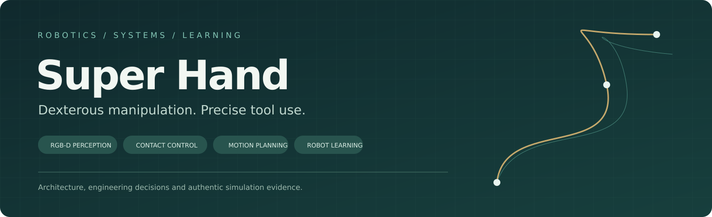
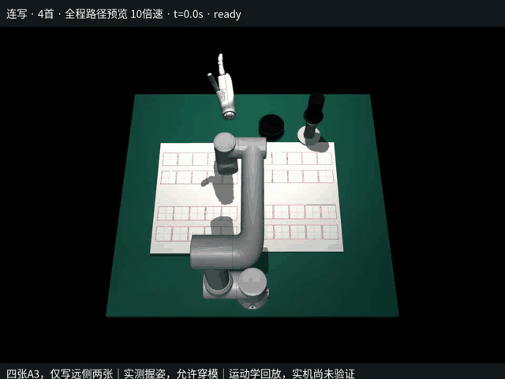
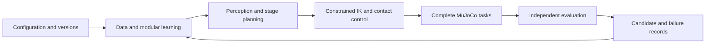

# Super Hand

**Dexterous manipulation and robot calligraphy**

RGB-D perception · Contact control · Constrained planning · Modular learning

[中文](README.md) · [Architecture](docs/ARCHITECTURE.md) · [Model card](docs/MODEL_CARD.md) · [Results](docs/RESULTS_AND_LIMITATIONS.md)

Super Hand investigates how a robot arm and a five-finger hand can hold a brush, preserve its tool relationship across multiple stages, and perform eye-dotting or continuous writing. The system combines perception, numerical kinematics, contact feedback, ink assessment, stage timing and device interfaces.

This repository contains public technical documentation, design diagrams, experiment summaries and authentic simulation media. Implementation, weights, executable applications, raw datasets and field calibration remain private.

## Demonstration

[MP4 video](media/finals-four-poems-10x.mp4) · [Media provenance](media/README.md)

The historical demonstration repeats **Shan Cun Yong Huai four times**, producing an 80-character, 420-stroke route. It covers preparation, grasping, lifting, ink dipping, writing, re-dipping, release and return. Recorded competition actions take 283.777 seconds, followed by 10.721 seconds of return motion.

This is a kinematic replay with model-level checks. Grasp/contact dynamics and a complete hardware run were not validated by this recording.

## Technical work

| Area | Work demonstrated in the project |
|---|---|
| Robot modeling | FR5 chain, hand/tool relationships, explicit frames and units |
| Contact control | Per-finger first-contact latching, normal-force feedback and bounded pose maintenance |
| Motion planning | Damped numerical solving, constrained IK, learned initialization and smooth timing |
| Perception | Four-channel RGB-D segmentation, depth projection and target organization |
| Learning | Segmentation, ink coverage, time regression, IK seeds and local PPO policies |
| Evaluation | Matched scenes and seeds, independent mechanical/ink/precision checks and retained failures |
| Engineering | Local workbench, worker processes, SDK integration, source/resource hashes and offline checks |

The detailed [technical portfolio](docs/PORTFOLIO.md) maps problems, design choices, implementation work and evidence. Detailed technical documents are currently in Chinese.

## Architecture

Learning modules provide segmentation, initial guesses, timing advice or bounded residuals. Explicit solvers and task logic retain geometric constraints and stage structure. A separate fixed-layout application branch uses taught endpoints and hand targets; its validation is tracked separately from the vision research path.

## Model and data

The archived RGB-D segmenter has **119,176 parameters**, a **256×256×4** input and **eight semantic classes**. Its saved fixture mIoU is **0.9150016**, averaged over stand, inkstone, paper and brush. This is a historical segmentation metric; the checkpoint hardware-validation flag is false.

Recorded settings include 320 synthetic images, 40 epochs, batch size 16 and seed 1044. These settings do not establish the completed dataset size or actual epoch count: the full image collection and training history are not included in the checkpoint.

Two historical simulator trajectories contain 7,745 and 23,795 sampled states, respectively. They come from different candidates and both retain `physical_round_qualified=false`. Raw trajectories and weights are not distributed here.

## Finite self-iteration

1. Freeze the scene, task, seed, version and weights.
2. Evaluate the complete baseline before learning.
3. Train one selected module while retaining the other inputs.
4. Compare the complete candidate under matched conditions.
5. Retain useful candidates, preserve rejected attempts and keep the previous best.
6. Run the required common-scene or repeated-layout checks.

Completion, first-pass ink, repair burden and time are compared separately. Reusing weights, searching parameters and updating a network have distinct records. GPU tensor throughput is measured separately from full physical-task throughput.

## Results and limits

| Record | Result | Scope |
|---|---|---|
| Historical vision checkpoint | Four-class fixture mIoU 0.9150 | Segmentation validation |
| Original V147 preliminary cohort | 14 passed / 16 failed | Same-version historical simulation cases |
| Four-poem-length video | 80 characters / 420 strokes | Kinematic replay |
| Clean-directory software check | Five pages/APIs, four synthetic frames, one CPU epoch | Offline software; no hardware opened |

Three regression issues also reproduce in the pre-curation implementation: a preliminary approach route takes 74.9069 seconds against its 30-second test budget; a whole-writing route takes 246.8833 seconds against its 150-second budget; and one scoped tool-clearance interface remains unintegrated. These are different fixtures from the demonstration video.

Full results, failure counts and verification levels are documented in [Results and limitations](docs/RESULTS_AND_LIMITATIONS.md), with a [machine-readable summary](evidence/summary.json).

## Reading guide

- [Portfolio](docs/PORTFOLIO.md): technical problems, decisions and work scope.
- [Control and planning](docs/CONTROL_AND_PLANNING.md): contact, IK and trajectory design.
- [Learning](docs/LEARNING.md): models, local policies and iteration.
- [Data and evaluation](docs/DATA_AND_EVALUATION.md): splits, audits and denominators.
- [Engineering](docs/ENGINEERING.md): workbench, processes, SDKs and deployment.
- [Public scope](PUBLIC_SCOPE.md) and [attribution](ATTRIBUTION.md).

Maintained by [Linhcry](https://github.com/Linhcry) · 2026
