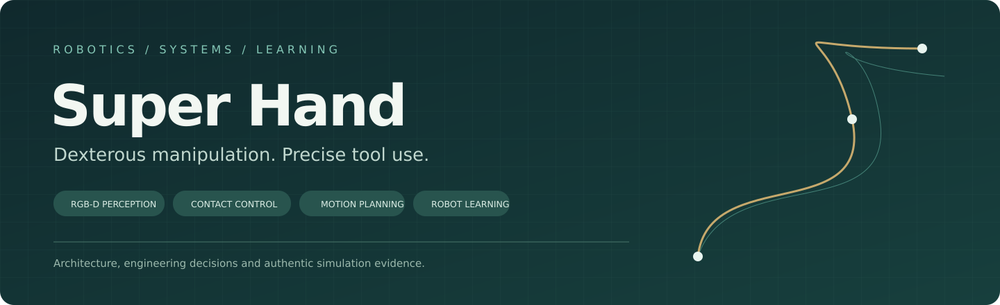
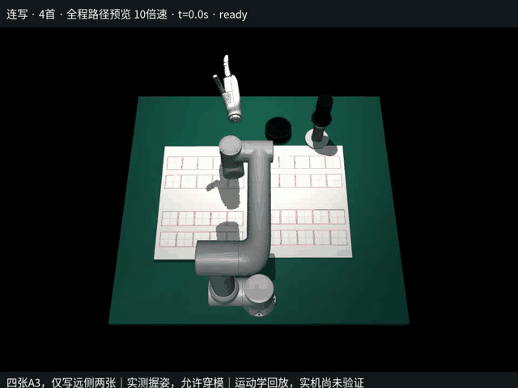
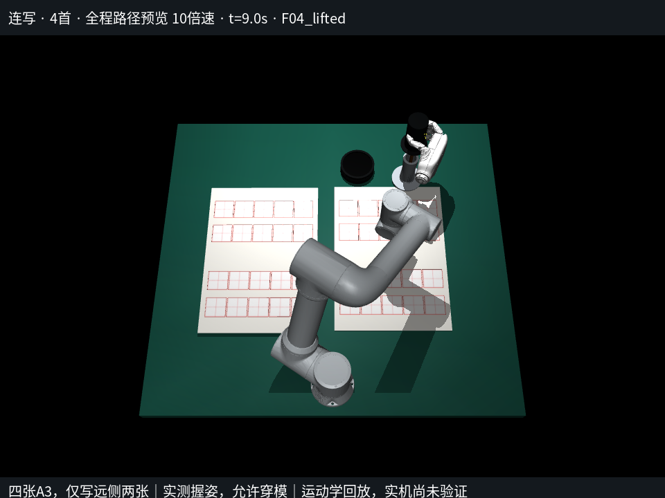
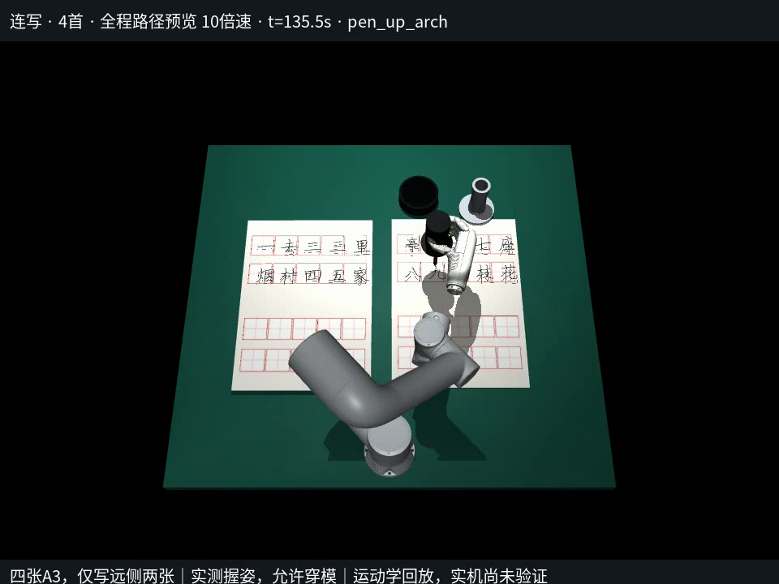
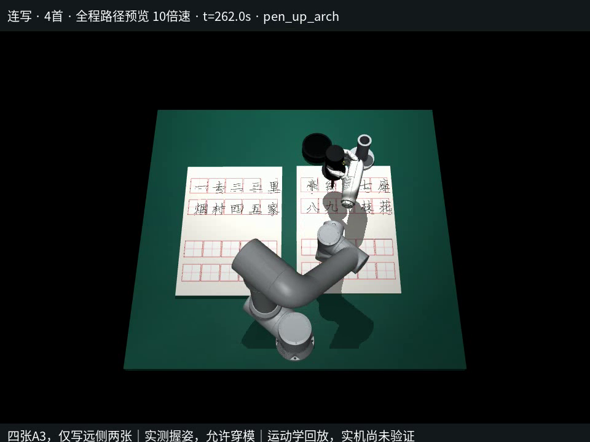
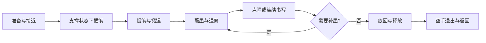
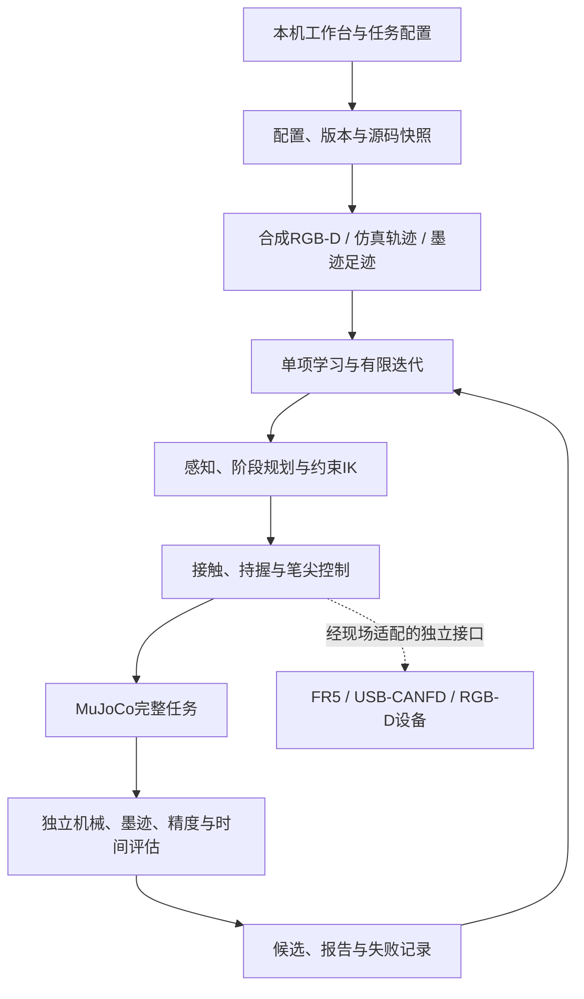

# Super Hand

**五指灵巧操作与机器人书写系统**

RGB-D感知 · 接触与持握控制 · 约束运动规划 · 分模块学习与完整任务评估

**[English](README.en.md) · [系统架构](docs/ARCHITECTURE.md) · [算法设计](docs/CONTROL_AND_PLANNING.md) · [训练与迭代](docs/LEARNING.md) · [结果与范围](docs/RESULTS_AND_LIMITATIONS.md)**

Super Hand围绕一个具体问题展开：机械臂如何用五指手拿稳毛笔，在多阶段工具操作中保持笔尖关系，并完成点睛或连续书写。项目把视觉、运动学、接触、墨迹、阶段时间和设备接口组织到同一条工程链路，分别记录模型效果、完整仿真和现场验证。

这个仓库公开技术说明、设计图、实验摘要和真实仿真素材。**实现源码、模型权重、可执行程序、原始数据与设备标定保持私有。**

## 先看效果

**四首篇幅 · 80字 · 完整路线10倍速运动学回放** 
[播放完整视频](https://github.com/user-attachments/assets/3ac18e4b-538f-496f-aa1b-ab49cad54b14) · [演示说明与来源](media/README.md)

录像覆盖准备、握笔、提笔、蘸墨、连续书写、补墨、放回和返回。比赛动作计时283.78秒，赛后返回10.72秒。历史演示采用《山村咏怀》重复4次，展示80字路线组织；它不是四个不同诗题的识别验收。原视频中的运动学、接触与实机验证说明完整保留。

在当前页面播放完整视频（10倍速）

https://github.com/user-attachments/assets/3ac18e4b-538f-496f-aa1b-ab49cad54b14

[下载原始MP4文件](https://github.com/Linhcry/super-hand-showcase/raw/refs/heads/main/media/finals-four-poems-10x.mp4)

| 工具与接近 | 纸面书写 | 全场布局 |
|:--:|:--:|:--:|
|  |  |  |

## 技术工作覆盖

| 方向 | 项目中的具体工作 | 对应文档 |
|---|---|---|
| 机器人系统建模 | FR5链条、手部模型、工具关系、坐标与单位管理，区分名义参数和实际标定 | [系统架构](docs/ARCHITECTURE.md) |
| 接触与操作控制 | 分指首次接触锁存、法向力反馈、接触Jacobian与有界姿态维护 | [控制与规划](docs/CONTROL_AND_PLANNING.md) |
| 运动学与路径 | 阻尼求解、约束IK、学习初值、平滑时间参数化、搬运与抬落笔阶段 | [控制与规划](docs/CONTROL_AND_PLANNING.md) |
| 视觉与几何 | 4通道RGB-D分割、相机反投影、纸面/目标定位，训练标签与运行观测分开 | [视觉模型卡](docs/MODEL_CARD.md) |
| 机器学习 | 分割、墨迹覆盖、时间回归、IK初值与局部PPO，统一输入、数据和候选管理 | [训练与迭代](docs/LEARNING.md) |
| 实验设计 | 相同场景和种子对照，独立机械/墨迹/精度检查，失败计入分母 | [数据与评估](docs/DATA_AND_EVALUATION.md) |
| 工程集成 | 本机工作台、进程管理、SDK适配、离线检查、来源摘要与版本恢复 | [工程实现](docs/ENGINEERING.md) |

详细的“技术问题→设计选择→实现内容→证据范围”见 [项目工作与能力映射](docs/PORTFOLIO.md)。

## 设计主线

### 学习提供建议，显式控制完成动作

视觉网络估计对象与空间关系，IK网络建议初值，时间模型估计剩余耗时，局部策略研究已有握姿附近的修正。几何求解、关节范围、工具关系和完整任务验收保留独立实现。

这样可以逐项比较学习模块带来的收益，定位错误来自识别、求解、接触还是阶段调度，也便于在设备与布局变化时复用可靠部分。

### 用工具流程组织系统

持握目标与笔尖任务分开管理。阶段切换同时关注动作状态、工具关系和剩余时间，避免只优化某段路径而忽略后续蘸墨、放笔和退出。

### 把实验变成可追溯的版本

每次候选保存配置、种子、源码/权重摘要、数据来源、轨迹、报告和失败原因。有限迭代先评估基底，只学习一个模块，再在相同条件下比较完整任务。保留或退回候选有明确依据。

[查看迭代流程和候选选择规则](docs/LEARNING.md#有限自我迭代)

## 模型与已有记录

| 记录 | 数值 | 适用范围 |
|---|---:|---|
| RGB-D分割网络 | **119,176参数**，256×256×4输入、8类输出 | 已保存历史模型 |
| fixture mIoU | **0.9150** | 笔筒、砚台、纸、毛笔四类平均；历史验证指标 |
| 四首诗演示 | **80字 / 420笔画** | 历史运动学回放 |
| 演示计时 | **283.78秒＋返回10.72秒** | 规划/回放时间，未证明实机用时 |
| 两份学习轨迹 | **7,745 / 23,795个采样时刻** | 不同历史候选；原始数组不公开 |
| V147原30初赛场景 | **14通过 / 16未通过** | 历史同版本场景组，保留全部失败分母 |

模型指标、单个演示、整组仿真和实机结果采用不同记录。四首诗录像未验证抓握接触动力学或完整实机比赛；3项原有软件回归问题也在结果页列明。

[模型卡](docs/MODEL_CARD.md) · [实验数据说明](docs/DATA_AND_EVALUATION.md) · [完整结果与局限](docs/RESULTS_AND_LIMITATIONS.md)

## 架构概览

系统还包含固定布局应用分支：由实际示教确定端点和手部目标，再组织工具流程。它与视觉研究路线共用部分运动学和记录方法，验证状态分别维护。

技术栈：**Python 3.12 · MuJoCo · PyTorch · NumPy / SciPy · OpenCV · FastAPI · FAIRINO SDK · USB-CANFD · RealSense**。

## 阅读路线

- **快速了解项目**：[项目工作与能力映射](docs/PORTFOLIO.md) → [演示案例](docs/CASE_STUDIES.md)。
- **评审算法细节**：[控制与规划](docs/CONTROL_AND_PLANNING.md) → [模型卡](docs/MODEL_CARD.md) → [训练与迭代](docs/LEARNING.md)。
- **评审工程质量**：[架构](docs/ARCHITECTURE.md) → [数据与评估](docs/DATA_AND_EVALUATION.md) → [工程实现](docs/ENGINEERING.md) → [结果与局限](docs/RESULTS_AND_LIMITATIONS.md)。

[文档目录](docs/README.md) · [公开内容范围](PUBLIC_SCOPE.md) · [来源与致谢](ATTRIBUTION.md)

---

Maintained by [Linhcry](https://github.com/Linhcry) · 2026
