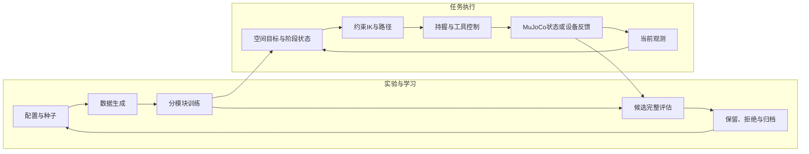

# 系统架构

## 分层

| 层 | 输入 | 主要处理 | 输出 |
|---|---|---|---|
| 任务与配置 | 任务范围、物理参数、模型、种子 | 校验、版本固定、进程派发 | 独立任务与配置快照 |
| 感知 | RGB、深度、相机标定、题面 | 分割、识别、反投影与目标组织 | 器具、纸面、龙眼或字格目标 |
| 阶段规划 | 当前关节、工具关系、目标和时间 | 阶段选择、IK、路径和时间参数化 | 机械臂轨迹与工具事件 |
| 控制 | 关节、接触、工具姿态和笔尖状态 | 闭合、维持握持、搬运、落笔、释放 | 仿真控制量或独立设备适配请求 |
| 评估 | 保存的状态、轨迹、墨迹与报告 | 机械、覆盖、精度、用时的独立检查 | 完整结果、失败原因与候选对照 |
| 数据与学习 | 合成图、仿真轨迹、足迹、标注 | 训练、标定、验证、有限迭代 | 模型和带来源的候选 |

## 两条应用路线

**视觉研究路线。** 每次由图像、深度和标定估计当前目标，再规划接近与书写。合成几何标签只用于训练，运行目标与执行后审计有不同来源字段。

**固定布局路线。** 已记录的端点与手部目标用于组织握笔、蘸墨、书写、放笔和返回，包含独立的准备与复位流程。四首诗演示属于这一类历史运动学回放。

两条路线共用部分运动学、工具阶段与记录方式，模型、实际标定和通过状态分别管理。固定布局演示不能证明视觉适应能力，单项视觉指标也不能证明现场固定流程已经跑通。

## 工具状态

系统同时维护机械臂关节、手部目标与反馈、笔尖相对变换、接触状态、墨迹/补墨阶段和剩余时间。目标姿态与实际反馈分开记录；阶段不只依靠固定延时推进。

准备、接近、闭合、提笔、蘸墨、写字、放回和空手退出分别有自己的几何关系。写字时需要关注工具与纸面的相对关系，放笔时需要处理筒口、支撑与释放顺序。

## 坐标与单位

- 机器人链条、法兰、手部、工具、纸面与相机使用明确的坐标关系。
- 界面参数中的毫米/角度与模型中的米/弧度显式区分。
- 工具尺寸、TCP变换和相机外参属于不同数据；一个长度无法确定完整工具坐标。
- 仿真默认值、示教记录、控制器读回和独立校验分别标注来源。

## 软件组成

Python负责实验与任务编排；MuJoCo负责模型、接触、仿真和渲染；PyTorch负责学习；NumPy/SciPy负责数值与几何；OpenCV处理图像和标注；FastAPI提供本机工作台接口。

实际设备适配使用FAIRINO SDK、USB-CANFD和RGB-D驱动。URDF/模型资源可在Python中使用，当前链路不依赖ROS进程运行。

[控制与规划](CONTROL_AND_PLANNING.md) · [工程实现](ENGINEERING.md)
