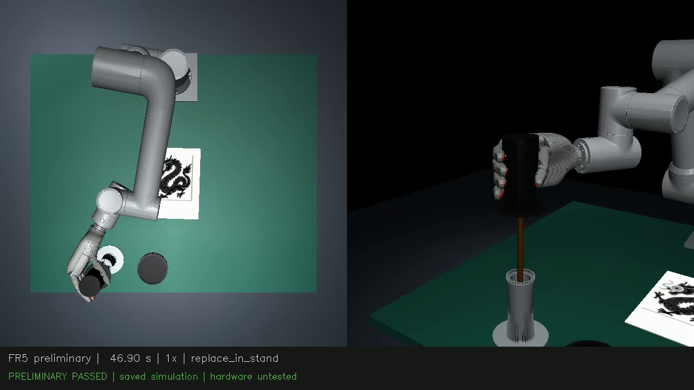
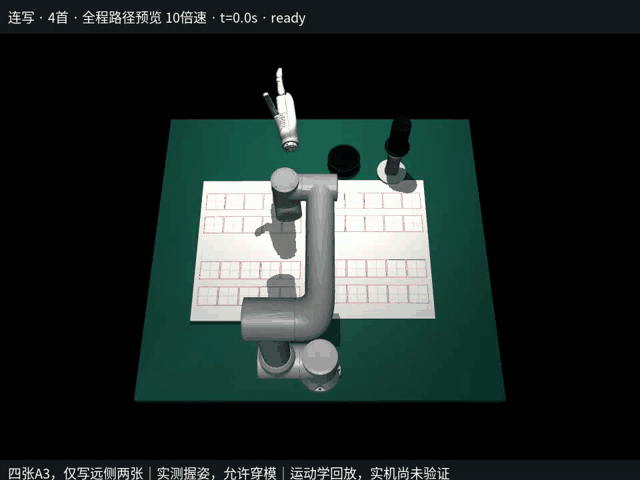

# 案例分析

## 初赛：毛笔点睛

**目标。** 完成取笔、提起、蘸墨、寻找龙眼、落笔、放回与退出，同时保持工具关系和时间预算。

**技术链路。** 图像/深度形成对象与落点观测，阶段规划生成接近和搬运目标，接触与持握控制维护工具，独立审计检查动作、机械、墨迹和精度。

**录像来源。** 图片取自V147指定案例的连续1倍速物理仿真视频，取帧时刻46.92秒。该案例历史完整用时78.160秒、五项检查通过且没有修补；同版本原30场景整体为14通过、16未通过。

**工程意义。** 单个案例可以用于检查阶段关系和定位故障，完整场景组用于评价同一版本的覆盖程度。两种证据都保留。

## 决赛演示：四首古诗连续书写

**目标。** 从工具准备到放回，在四首篇幅、80字的历史方案中组织420个笔画、补墨和跨区域动作。演示文本为《山村咏怀》重复4次，不代表四种不同诗题的识别验收。

**技术链路。** 已确定的布局和工具关系生成笔尖路线，进行运动学求解与时间参数化，把握笔/补墨/释放等离散事件和连续轨迹组织到同一计划。

| 记录 | 数值 |
|---|---:|
| 诗篇数 | 4 |
| 字数 | 80 |
| 笔画 | 420 |
| 轨迹采样时刻 | 23,331 |
| 比赛动作时间 | 283.777秒 |
| 赛后返回 | 10.721秒 |
| 总时间 | 294.499秒 |
| 回放倍率 | 10倍 |

**验证范围。** 这是历史运动学回放，报告记录模型中的机械臂穿透检查通过。抓握接触动力学和完整实机执行没有由该回放验证，规划参数也不是硬件可直接采用的速度配置。

**工程意义。** 它展示了多阶段工具操作、连续字形路径、补墨与离散事件的组织能力，并提供完整计时和可追溯的路线演示。

## 视觉模型：把图像输出接到几何目标

RGB-D网络提供8类像素标签，深度与内外参把像素转换为空间线索。模型轻量，便于本地训练和部署；几何求解器与任务评估保持独立。

历史checkpoint的四类fixture mIoU为0.9150。它支持分析感知模块效果，任务是否完成仍由单独的完整流程报告说明。

[模型卡](MODEL_CARD.md) · [控制与规划](CONTROL_AND_PLANNING.md) · [结果与局限](RESULTS_AND_LIMITATIONS.md)
