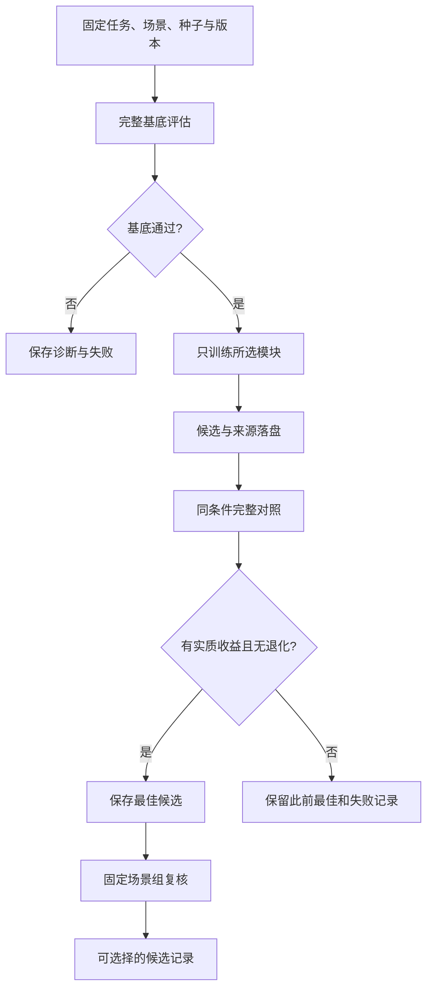

# 训练、局部策略与有限迭代

## 学习模块

| 模块 | 输入与网络 | 优化方法 | 任务作用 |
|---|---|---|---|
| 物体分割 | 256×256 RGB-D，轻量编码器/解码器，8类 | AdamW＋类别加权交叉熵 | 对象类别、边界与空间定位线索 |
| 墨迹覆盖 | 125→192→128→64→1，SiLU | 加权BCE，独立阈值标定 | 局部足迹覆盖判定 |
| IK初值 | 21→128→128→6，SiLU/Tanh | AdamW＋Smooth L1 | 数值IK的关节初值建议 |
| 剩余时间 | 34→64→64→1，SiLU/Softplus | AdamW＋Smooth L1 | 阶段耗时建议 |
| 持握残差 | 42维观测、12维动作，两层128 Tanh | PPO＋GAE | 已有握姿附近的局部修正 |
| 视觉响应 | 8维观测、1维增益 | PPO，Torch批量响应环境 | 简化误差响应中的增益选择 |

当前有可核对的历史分割权重和指标。其他模块提供实现及数据管线，不能据此推定每类模型都有已通过完整任务的权重。

## RGB-D视觉训练

MuJoCo输出RGB、深度与几何ID标签。训练在固定种子下划分训练/验证，支持分阶段姿态、位置与转角变化、光照、相机高度、桌面颜色和像素噪声。

实拍增量标签有独立来源和训练/验证角色。保存的视觉checkpoint包含模型状态、类别、图像尺寸、配置、指标与校正元数据；完整模型卡单独说明历史记录范围。

## 墨迹覆盖

125维输入由11×11局部块的121个值，加亚像素位置和笔尖投影尺度组成。训练器定义100,000训练、24,000标定、24,000测试足迹，使用不同种子。

分类损失增加对负类误判的代价。阈值结合标定集负类最大logit与既定阈值，之后在独立测试集检查。生成器规模是配置，不能直接当作已归档完成样本量。

## IK初值与时间回归

IK模型的21维输入由六轴sin/cos、相对目标位移、工具偏置和工具轴组成。标签来自原约束IK的关节增量，训练/验证按目标来源分组。

时间模型用六轴sin/cos、20阶段one-hot、已用时间和任务标记组成34维输入，拟合完整成功仿真轨迹的剩余时间，并保留来源轨迹上界。它辅助预算判断，不负责生成目标位姿。

## PPO作用范围

**持握残差策略。** MuJoCo自由工具体与接触环境中的42维观测包括关节、速度、接触、工具相对位置、轴线及时间。高斯动作经tanh压缩，在原目标上施加有界残差。奖励覆盖保持、竖直性、代价、平滑和掉落，支持质量/摩擦随机化。

**视觉响应策略。** 8维状态描述误差、差分、积分、噪声和上一增益。Torch批量环境模拟时延、滞后、噪声和负载变化，输出0.25～1.5的单增益。该环境不是完整机器人比赛物理仿真。

两类策略使用PPO/GAE的局部学习思路，典型gamma为0.99、lambda为0.95、ratio clipping为0.8～1.2。简化环境奖励、持握奖励和完整任务结果分别保存。

## 有限自我迭代

1. 固定输入与版本，先确认当前基底在对应范围内通过完整检查。
2. 只训练一个模块；其余配置、场景和种子保持一致。
3. 训练开始前保存候选尝试，训练中断也保留分母和原因。
4. 对候选执行完整任务，比较完整度、首次落墨、修补负担及用时。
5. 保留有明确收益的候选，退化或没有收益则保留此前最佳。
6. 最终按入口要求进行共同场景或固定布局重复复核。

常规视觉迭代最多3个候选；固定数据上的墨迹和时间拟合通常各1个。实质用时差采用至少5秒或5%的判定边界，时间收益不能抵消已知完整度或墨迹退化。

这里的自我迭代是本地训练器、仿真器与比较规则的有限编排。仅复用权重、重新规划或搜索参数有独立标记，不计为网络权重更新。

## CPU与GPU

网络前向、反向和简化批量响应环境可以使用CUDA。当前完整MuJoCo物理、IK、任务调度和部分渲染有独立的CPU或图形开销。

静态候选数、网络更新速度、完整物理任务吞吐量和最终成功率分别测量。高GPU利用率本身不说明完整任务更可靠。

[模型卡](MODEL_CARD.md) · [数据与评估](DATA_AND_EVALUATION.md)
