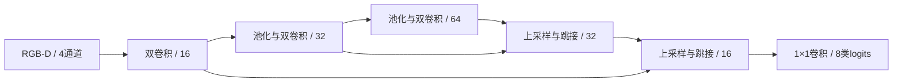

# RGB-D视觉模型卡

## 已保存模型

| 项目 | 记录 |
|---|---|
| 模型标识 | 历史RGB-D Segmenter，2026年10月归档 |
| 结构 | 轻量编码器/解码器＋跳接 |
| 参数量 | 119,176 |
| 输入 | 256×256，RGB＋深度共4通道 |
| 输出 | 8类像素标签 |
| 类别 | background、table、stand、inkstone、paper、robot、brush、display |
| 原始checkpoint大小 | 491,557字节，约0.49MB |
| 保存指标 | fixture mIoU = 0.9150016009807587 |
| 指标类别 | stand、inkstone、paper、brush的IoU算术平均 |
| 实机验证标志 | false |
| 原始checkpoint SHA256 | `3d9bbaf1c8645f1f2b3d4dd8a21bc30de7abd74692c4474aae767b84358d3598` |

模型权重保持私有，本页公开结构、配置和已保存指标。

## 结构

双卷积块使用3×3卷积、4组GroupNorm与SiLU。编码通道16→32→64，解码将深层特征和对应尺度边界信息结合。

## 训练记录

| 配置项 | checkpoint记录值 |
|---|---:|
| 随机种子 | 1044 |
| 合成样本配置 | 320 |
| epoch配置 | 40 |
| batch size | 16 |
| 学习率 | 0.00035 |
| 优化器 | AdamW |
| 计算设备 | CUDA |
| 位置随机化配置 | ±40mm |
| 平面转角随机化配置 | ±15° |

训练使用类别加权交叉熵，标签255忽略；按固定种子留出约20%合成数据作验证。可加入显式分开的实拍训练和验证帧。CUDA训练启用bfloat16 autocast。

这些是checkpoint保存配置。完整生成量、实际完成epoch数、实拍帧数量和全程训练曲线没有全部附在checkpoint中，本展示不将它们补写为已完成记录。后续研究工作区曾采用不同扰动范围，与这份模型的历史配置分开说明。

## 设计作用

- RGB提供外观，深度提供空间线索。
- 跳接保留细节，轻量通道降低本地训练和推理成本。
- GroupNorm减少归一化对batch规模的依赖。
- 固定类别、标定关系和来源记录便于与几何规划连接。

这些是结构上的设计理由，没有附上与大型网络的统一硬件速度对照或真实场景泛化基准。

## 使用范围

mIoU是四类像素分割指标，不是抓握成功率或整轮比赛通过率。该模型的历史验证不能自动转移到新光照、遮挡、相机内外参或设备布局。

相机反投影需要实际内外参；对象轮廓、可见性和目标定位还需要独立检查。仿真标签真值用于监督训练和执行后审计，运行中的目标仍需来自观测。

[训练方案](LEARNING.md) · [数据与评估](DATA_AND_EVALUATION.md)
